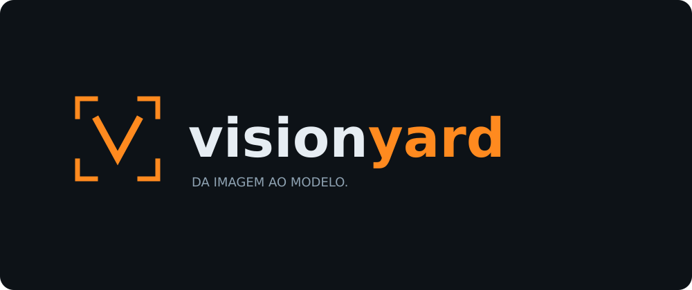

  

  Organize imagens, anote, treine e acompanhe seus modelos de visão computacional em um só lugar.
   
  <strong>Você controla os dados. Suas máquinas executam os treinos.</strong>

## Da imagem ao modelo

## O que você pode fazer

| | No Visionyard |
|---|---|
| **Organizar e anotar** | Reúna imagens e mantenha o histórico das anotações de cada pessoa. |
| **Versionar datasets** | Preserve os dados usados em cada treino para comparar resultados. |
| **Treinar do seu jeito** | Escolha a máquina e ajuste os hiperparâmetros em um painel separado, com importação e reutilização de configurações. |
| **Acompanhar resultados** | Veja o progresso, as métricas e as versões dos modelos pela interface. |
| **Colocar em operação** | Exporte modelos para ONNX ou TensorRT e gerencie a publicação e o deploy. |

## Comece por aqui

- **Instalar a plataforma:** [ambiente local](docs/guia-tecnico.md#subir-desenvolvimento) ou [produção](docs/guia-tecnico.md#subir-produção).
- **Conectar suas máquinas:** [guia do agente](agent/README.md).
- **Personalizar o treinamento:** [configurações e presets](docs/guia-tecnico.md#personalizar-um-treino).
- **Entender a parte técnica:** [arquitetura, configuração e testes](docs/guia-tecnico.md).
